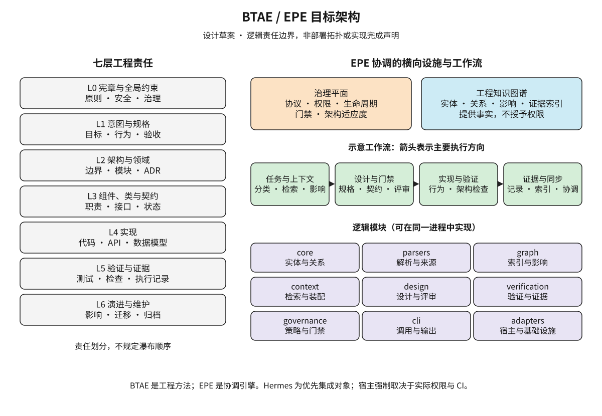

# BTAE / EPE

本仓库包含 BTAE（Bottom-Up Traceable Agentic Engineering）的本地工程协议引擎 MVP。实现位于 `src/epe/`，权威设计和规格位于 `docs/`，机器约束位于 `engineering/`。

## 架构概览

下图展示 BTAE / EPE 的目标架构，包括七层工程责任、治理平面、工程知识图谱和逻辑模块。它是设计草案，不代表所有目标能力或宿主集成均已实现；七层也不规定瀑布式执行顺序。



可下载 [可编辑的 draw.io 图](docs/architecture/figures/btae-target-architecture.drawio)或 [PDF 版本](docs/architecture/figures/btae-target-architecture.pdf)。架构的设计依据和模块边界分别见[总体架构](docs/architecture/overview.md)和[模块与依赖边界](docs/architecture/boundaries.md)。

## 本地运行

MVP 上手和故障恢复步骤见 [使用指南](docs/standards/user-guide-mvp.md) 与 [恢复手册](docs/standards/runbook-recovery.md)。

无需安装到系统环境时可使用 `PYTHONPATH=src`：

```bash
PYTHONPATH=src python -m epe.cli --format json init
PYTHONPATH=src python -m epe.cli inspect
PYTHONPATH=src python -m epe.cli graph build
PYTHONPATH=src pytest -q
```

任务已关联 ChangeSet 后，可填写 `engineering/templates/changeset.yaml` 并运行 `epe changeset create --file PATH` 登记当前范围基线。完成检查会比较基线后的新增、修改和删除；审计目录、缓存、虚拟环境和报告不在比较范围内，具体边界见 [治理模块设计](docs/modules/governance/README.md)。

缺少设计时可运行 `epe design create CLASS-001`（或其他已支持实体前缀）生成草案模板；命令不会覆盖已有文件。契约设计使用 `CONTRACT-` 前缀和 YAML Schema 字段，审批必须使用配置的受信 SSH 公钥签名。

任务可用 `epe task transition TASK-001 activate|complete|abort` 进行受约束的生命周期迁移；bugfix/refactor/exploration 分别需要复现、基线或假设字段。完成时系统重新执行只读综合门禁，不接受调用者自报通过结果。

审批导入会追加本地 hash-chain 审计事件，可用 `epe audit verify` 检查；这能发现篡改但不替代远程不可变审计或宿主权限保护。

可用 `epe policy validate` 在运行任务前统一检查架构、验证和 Workflow 配置。

也可以在虚拟环境中执行 `pip install -e .`，随后直接使用 `epe` 命令。`epe init` 只创建缺失的治理配置，发现内容冲突会在写入前返回 `blocked`，不会覆盖既有文件。

运行时策略 Schema 已随 wheel 包发布，因此安装后的 `epe policy validate` 不依赖当前源码仓库的 `engineering/schemas` 目录。

当前 MVP 支持实体/关系解析、Python AST 与映射、基础依赖图、架构校验、任务登记、ChangeSet 基线、设计生成/契约校验、签名审批、授权检查运行、Evidence 新鲜度和综合 `check`；同时提供基于图的可解释 `impact analyze`、增量计划和带失效缓存的无外部语义服务 C0–C2 `context resolve`。尚未配置宿主文件系统隔离。

CLI 的 JSON 输出遵循 `engineering/schemas/command-result.schema.json`，退出码为：0 成功、1 门禁阻断、2 参数/配置错误、3 执行或存储故障、4 未支持命令、5 写入冲突。

本项目没有将实现状态等同于方法效果验证。PRD 中的收益、召回率和成本指标仍需独立试点与验收记录。
