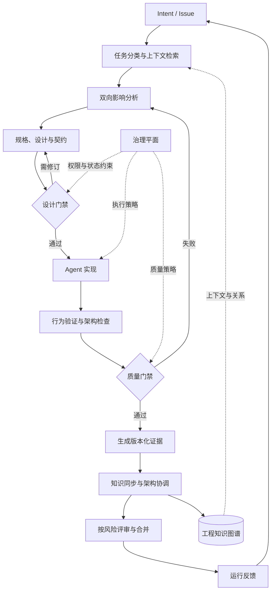

# BTAE 总体架构

## 1. 定位与目标

BTAE（Bottom-Up Traceable Agentic Engineering，自下而上的可追溯智能体工程模式）是一套约束 AI 如何理解项目、设计代码、执行开发、验证结果和维护工程知识的通用方法。

目标是降低长期 Agent 开发中的设计漂移、影响遗漏与维护成本。Hermes 是优先落地对象，工程协议独立于具体 Agent 和宿主产品。方法的有效性仍需实验验证。

## 2. 对原有文档方案的调整

| 原有做法 | 问题 | BTAE 调整 |
| --- | --- | --- |
| 每个代码文件一份文档 | 文件不等于设计实体，文档膨胀 | 按逻辑实体建模，通过映射连接文件与符号 |
| 类文档与代码一一对应 | 忽略协作与公共契约 | 核心类独立设计，模块与组件定义协作契约 |
| 统一文档状态 | 混合设计、实现与验证生命周期 | 分离状态与证据有效性 |
| 完全自下而上 | 局部最优和架构腐化 | 顶层约束、底层构建、双向协调 |
| 人工同步文档和代码 | 易遗漏、成本高 | 自动索引、映射校验、分级漂移检测 |
| 所有任务统一流程 | 不适合修复、重构与探索 | 多入口、统一治理协议 |

## 3. 六项原则

1. **Design Before Implementation**：重要实现必须有明确设计依据。
2. **Entity-Centric Documentation**：以逻辑类、组件、模块组织设计知识。
3. **Bidirectional Traceability**：连接设计、契约、实现、测试与证据。
4. **Constraint-Guided Bottom-Up Evolution**：底层构建接受顶层架构约束。
5. **Evidence-Based Governance**：以可追溯验证结果支撑完成声明。
6. **Context-Aware Agent Execution**：按任务获取上下文、分析影响并执行授权范围内的工作。

## 4. 七层工程体系

| 层 | 名称 | 主要责任 | 主要产物 |
| --- | --- | --- | --- |
| L0 | Engineering Constitution | 原则、规范、安全与全局治理 | 宪章、约束、安全要求 |
| L1 | Intent & Specification | 目标、需求、行为与验收 | Intent、Spec、验收条件 |
| L2 | Architecture & Domain | 系统边界、模块、领域与决策 | 架构模型、模块契约、ADR |
| L3 | Component & Class Design | 职责、接口、状态与协作 | 类/组件设计、机器契约 |
| L4 | Implementation | 实现设计和契约 | 代码、API、数据模型、工具 |
| L5 | Verification & Evidence | 验证行为并记录执行结果 | 测试、评估、构建、证据 |
| L6 | Evolution & Maintenance | 分析变化、协调架构与维护知识 | 影响报告、技术债、迁移与归档 |

七层划分知识与执行责任，不规定瀑布顺序。Bugfix 可以从 L5 的失败证据进入 L3；Exploration 可以先验证假设，再形成正式设计。

## 5. 横向设施及运行组件

**Engineering Governance Plane** 决定操作是否允许执行，管理 Agent Protocol、权限、状态迁移、CI/CD 门禁及架构适应度函数。

**Engineering Knowledge Graph** 组织实体、关系、依赖、影响传播与证据索引，为检索和治理提供带来源的事实。它不授予权限，也不自行批准设计。

运行时由 EPE 协调：KG 提供知识能力，VE 提供验证与证据能力，AG 提供 Agent 治理能力。它们初期是逻辑职责边界，可在单进程中实现，避免重复建设多个独立平台。

## 6. 自下而上与双向架构治理

基本组织关系为 Architecture → Module → Component → Class → Implementation。简单项目允许 Module 直接组织 Class；函数式与服务型系统可直接映射 Component 到函数、API 或数据模型，不强制所有实现面向对象。

同时维护两种架构：

| 模型 | 来源 | 用途 |
| --- | --- | --- |
| Intended Architecture | 经授权的设计、契约和 ADR | 约束边界与依赖 |
| Discovered Architecture | 静态分析、配置、依赖注入与运行 Trace | 描述已观测实现 |

比较后，合法演进更新设计与 ADR，偏差修复实现。发现模型必须声明分析范围和盲区；扫描 import 不能完整重建系统架构。

## 7. 初期范围

首先交付轻量 EPE：实体注册、文档解析、代码解析、映射校验、依赖图、设计门禁、测试门禁和证据记录。图数据库、完整多 Agent 编排、复杂向量检索与全自动语义裁决均不属于首版必须能力。

详细边界见[模块设计](boundaries.md)，执行方式见[工程协议](engineering-protocol.md)。
