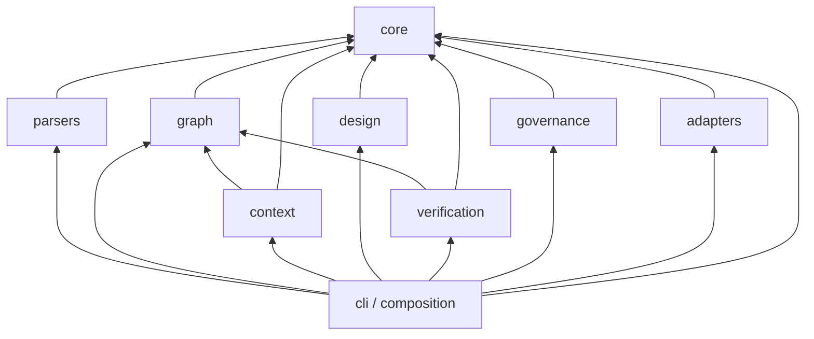

# EPE 模块设计索引

本目录将[架构边界](../architecture/boundaries.md)细化为 9 个模块设计。9 个模块均已有可运行的本地基线实现和测试；外部宿主、远程审计、多语言扩展和研究评测保持为明确 deferred 范围。所有设计仍处于草案或待评审状态，文档不等同于批准。

模块实现/验证状态与本地证据同步记录在 [模块状态审计](../../reports/evaluations/module-status-audit.json)；状态表示本地仓库基线，不覆盖 deferred 外部能力。

总体执行安排见[实施计划](../../plans/backlog/BTAE-implementation-plan.md)，产品需求和验收编号分别来自 [PRD](../intent/PRD-BTAE.md) 与 [SPEC](../intent/requirements/SPEC-BTAE.md)。

## 1. 模块清单

| ID | 模块 | 责任 | 首次交付 |
| --- | --- | --- | --- |
| MOD-001 | [core](core/README.md) | 模型、注册、关系、状态、公共端口 | 已实现本地基线 |
| MOD-002 | [parsers](parsers/README.md) | 文档、YAML、Python AST 与来源定位 | 已实现本地基线 |
| MOD-003 | [graph](graph/README.md) | 图快照、查询、重建、影响与增量计划 | 已实现本地基线 |
| MOD-004 | [context](context/README.md) | 分级上下文、检索、缓存与可信度呈现 | 已实现本地基线 |
| MOD-005 | [design](design/README.md) | 设计、契约、评审记录与批准适用性 | 已实现本地基线 |
| MOD-006 | [verification](verification/README.md) | 映射、架构、测试检查与 Evidence | 已实现本地基线 |
| MOD-007 | [governance](governance/README.md) | Policy、权限、工作流、门禁决策 | 已实现本地基线 |
| MOD-008 | [cli](cli/README.md) | 命令、装配、输出与退出码 | 已实现本地基线 |
| MOD-009 | [adapters](adapters/README.md) | 文件、Git、进程、身份、CI 与 Agent 适配 | 已实现本地基线；宿主 deferred |

目标实现位置为 `src/epe/<module>/`，测试位置为 `tests/unit/<module>/` 及跨模块集成测试。这是包布局建议，不要求按本文中的逻辑组件机械拆成等量文件。实现前，核心类仍需独立类设计和接口契约。

架构导入检查使用默认允许依赖表，并允许在版本化架构策略中登记显式兼容例外；例外不会自动提升为设计约束，后续重构必须保留影响和理由。

## 2. 编译期依赖约束

箭头和“允许依赖”表示 Python 包导入方向，不表示运行时调用方向。外部效果通过 `core` 中的端口注入，具体实例在 `cli` 组合入口装配。

| 模块 | 允许直接依赖的内部模块 |
| --- | --- |
| core | 无 |
| parsers | core |
| graph | core |
| context | core、graph |
| design | core |
| verification | core、graph |
| governance | core |
| adapters | core |
| cli | 其余八个模块 |

`governance` 消费标准化检查事实，不导入检查器实现；`adapters` 实现端口，不导入业务服务。这样验证、授权与基础设施互不形成循环。实现 CI 应将该表转为可执行规则；当前没有导入检查器。

## 3. 共享协作约定

- 跨模块传递 `core` 定义的值对象：Entity、Relation、Diagnostic、InputManifest、RegistrySnapshot、CheckResult、GateDecision、EvidenceRecord 等。具体字段以冻结后的 Schema 为准。
- 计算型服务返回结构化结果和诊断；预期的规则不满足不通过异常掩盖。存储、进程等异常转换为带来源的执行故障，不能转换为通过。
- 所有结果附输入指纹和适用范围；状态计算读取同一快照。门禁执行前后的版本检查防止读取过期设计或结果。
- 文件路径使用仓库相对路径；存储、时钟、Git、进程与可信身份均通过端口访问。核心模块不能读取环境推断权限。
- 标记来源与可信状态，显式声明、静态发现和模型推断不能互换。`confidence: 1.0` 不是授权或证明。
- 共享索引 `.engineering/` 可删除重建；Task、Approval、Evidence 等审计记录不以缓存代替。写入使用单写者控制与完整快照发布。
- 诊断编号建议以模块名开头，例如 `CORE_DUPLICATE_ID`、`VERIFY_ZERO_TESTS`；编号在机器契约冻结后稳定，消息可改写而编号不复用。

## 4. 横向能力归属

| 能力 | 负责模块 | 协作方式 |
| --- | --- | --- |
| Mapping Validator | verification | 消费 parsers 产物与 core 注册快照 |
| Architecture Validator | verification | 消费 graph 快照和治理提供的有效规则 |
| Design / Contract Validation | design | 验证设计内容及接口契约；运行行为验证由 verification 承担 |
| Approval Applicability | design | 检查内容绑定；身份事实来自 adapters，权限裁决由 governance 承担 |
| Evidence Manager | verification | 解释执行事实和有效性；adapters 只存取产物 |
| Gate Manager | governance | 聚合检查事实并形成允许/阻断决策 |
| Knowledge Synchronization | graph + cli | graph 计算新快照，cli 调用 adapters 发布 |
| Agent Protocol | governance + adapters | 前者决定权限，后者集成宿主执行能力 |

## 5. 变更规则

模块文档负责职责和协作，不复制完整 SPEC 字段表。公共接口、允许依赖或工件权威来源改变时，先更新对应模块、SPEC 和必要架构决策，再实施变更。模块工作包与验收入口见各自第 8 节及总体计划。
