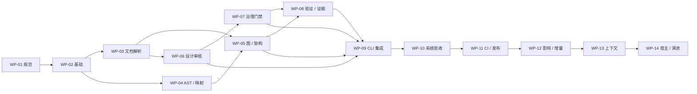

# BTAE 工程规范与 EPE 实施计划

**状态：** planned
**创建日期：** 2026-10-31
**计划负责人：** 项目维护者，执行人员待分配
**设计基线：** PRD / SPEC v0.1 草案、ARCH-001、MOD-001 至 MOD-009
**实施状态：** in_progress；V0.1 机器工件、V0.2 本地 MVP 骨架和基础测试已交付，完整验收与 CI 仍待完成。

## 1. 目标、范围与授权边界

将现有 BTAE 架构转为可执行规范和轻量 EPE，先完成单仓库 Python 工程的设计→实现→验证→证据闭环，再扩展影响分析、上下文和 Agent 宿主集成。

本计划覆盖 [9 个模块](../../docs/modules/README.md)。MVP 八项能力并不等于八个包：映射和 Evidence 位于 verification，门禁位于 governance，基础设施和 CLI 是横向支持。

当前任务交付是计划与模块文档；实施工作包仍待执行。本文不授予未来高风险实现的通用批准，不预先填写通过证据，不创建远程任务或派发 Agent。WP 编号只是本计划的工作分解，执行时再创建正式 Task / ChangeSet。

正式实现只进入明确范围的 `src/epe/`、`engineering/`、`tests/`、必要 CLI/CI 配置及对应设计。核心架构、公共协议、审批和身份边界变更按高风险规则记录授权。

## 2. 当前基线与待补项

| 项目 | 当前状态 | 下一步 |
| --- | --- | --- |
| AGENTS、PRD、SPEC、架构 | 已有草案 | 一致性评审与版本冻结 |
| 9 个模块设计 | 本次形成草案 | 核对公共接口与依赖，补核心类设计 |
| Schema、Policy、Workflow、模板 | 已交付初版 | WP-01 继续冻结与迁移 |
| 包、代码、自动化测试 | 本地 MVP 已交付，仍需扩展 | WP-02 起分批完善 |
| CI、审批可信通道、宿主隔离 | 不存在 | 明确边界后分阶段接入 |
| 性能和方法收益 | 无基线 | 原型与试点测量，不预设提升比例 |

需求权威为 [PRD](../../docs/intent/PRD-BTAE.md)，技术行为见 [SPEC](../../docs/intent/requirements/SPEC-BTAE.md)。下述验收编号引用 SPEC 的 AC-01 至 AC-12。

## 3. 里程碑与退出条件

| 里程碑 | 工作包 | 可审查交付 | 退出条件 |
| --- | --- | --- | --- |
| M0 / V0.1 | WP-01 | 规范、机器契约、模板、依赖表 | 关键歧义已决策，Schema 正反例可校验 |
| M1 / V0.2 基础 | WP-02 至 WP-05 | 注册、解析、映射、图与静态架构检查 | AC-02/03/04 和重建部分 AC-10 通过 |
| M2 / V0.2 闭环 | WP-06 至 WP-09 | 设计审核、门禁、测试运行、Evidence、CLI | 单任务正常闭环与阻断场景可运行 |
| M3 / V0.2 发布 | WP-10、WP-11 | 完整验收、恢复、CI、使用样例 | AC-01 至 AC-12、PRD KR-01 至 KR-05 满足 |
| M4 / V0.3 | WP-12、WP-13 | 双向影响、增量图、分级上下文 | 新增独立基准与回归验收通过 |
| M5 / V1.0 | WP-14 | 宿主适配、完整工作流、协作治理 | 能力与权限边界实测，长期试点可回溯 |

工期在 M0 完成技术试验和人员分配后估算。里程碑是依赖与验收顺序，不是承诺日期。

## 4. 工作包依赖

WP-03 与 WP-04 可在契约冻结后独立推进；WP-06 不依赖完整图。WP-07 先使用固定事实验证纯决策，真实检查事实在 WP-09 接入，避免治理和验证互相等待。可并行的工作不自动意味着本次启用多 Agent。

## 5. 详细工作包

各包的任务分解、拟议路径、决策/场景矩阵与完成门槛见 [工作包细化计划](work-packages/README.md)。下列条目保留总览；执行时以对应细化文档为准。

### WP-01：冻结规范、机器契约和样例

- **细化：** [WP-01-spec-freeze.md](work-packages/WP-01-spec-freeze.md)
- **负责模块：** 全部模块，core / governance / design 牵头；前置为现有草案。
- **步骤：** 逐项核对 PRD→SPEC→模块→AC；冻结字段、ID、关系端点、状态迁移、错误和结果模型；建立版本化 Schema 与正反例。
- **交付：** Entity、Relation、Task、ChangeSet、Approval、Evidence、Policy、Workflow Schema；模块/组件/类/ADR/任务模板；CLI 结果与端口契约。
- **必须决策：** 审批记录及可信配置位置、指纹范围、撤销顺序、快照 generation 格式、锁恢复、Evidence 保留期、混合故障退出码优先级（细化文档 D-01–D-15）。
- **验收：** 重复键、未知字段、非法枚举/端点/状态有反例；批准操作不导致自身设计指纹变化；运行结果不导致源 manifest 自失效。
- **完成条件：** 对关键公共协议取得适用评审，未决定项列为阻断或明确延期，不能靠实现自行猜测。

### WP-02：工程骨架、领域模型与最小端口

- **细化：** [WP-02-core-skeleton.md](work-packages/WP-02-core-skeleton.md)
- **负责模块：** [core](../../docs/modules/core/README.md)、[adapters](../../docs/modules/adapters/README.md)、[cli](../../docs/modules/cli/README.md)；前置 WP-01。
- **步骤：** 建立 `pyproject.toml` 和 `src/epe/` 包；实现核心模型、注册、诊断和状态迁移；实现受限文件读取、Git 来源与 Clock；建立可运行 CLI 入口。
- **交付：** 公共 DTO、必要端口、注册快照、最小 inspect、基础测试环境及核心类设计。
- **验收：** 重复 ID 不覆盖、无提交 commit=null、dirty 包含未跟踪文件、旧 revision 迁移冲突；core 不依赖其他内部包。
- **完成条件：** 可安装运行入口，真实支持命令与尚未支持命令明确区分，模型与 Schema 一致。

### WP-03：文档与结构化工件解析

- **细化：** [WP-03-doc-parsers.md](work-packages/WP-03-doc-parsers.md)
- **负责模块：** [parsers](../../docs/modules/parsers/README.md)、core；前置 WP-02。
- **步骤：** 严格读取 Markdown Frontmatter 与 YAML；保留源位置；区分普通说明与实体声明；构建文档事实批次并注册引用。
- **交付：** DocumentParseResult、结构化解析器、正反样例和解析统计。
- **验收：** AC-02 的重复 ID、重复键、悬空关系及解析故障可定位；普通 Markdown 不被猜成已注册设计。
- **完成条件：** incomplete 不能以完整成功发布；解析器不执行目标文档代码。

### WP-04：Python AST、符号与映射检查

- **细化：** [WP-04-ast-mapping.md](work-packages/WP-04-ast-mapping.md)
- **负责模块：** parsers、[verification](../../docs/modules/verification/README.md)；前置 WP-02。
- **步骤：** 提取限定类/函数、签名、异步和静态导入；实现相对导入定位与盲区记录；结合设计映射检查实际文件/符号。
- **交付：** CodeParseResult、符号索引、Mapping Validator 和多文件/同文件多实体样例。
- **验收：** AC-03；删除已实现符号阻断；动态 import、语法不支持和歧义导入显式报告。
- **完成条件：** 不 import 目标代码，无副作用执行；未来未实现映射不伪装成已通过实现校验。

### WP-05：基础图、架构规则与快照发布

- **细化：** [WP-05-graph-architecture.md](work-packages/WP-05-graph-architecture.md)
- **负责模块：** [graph](../../docs/modules/graph/README.md)、verification、adapters；前置 WP-03、WP-04。
- **步骤：** 组合注册与代码事实，建立正反邻接；按模块归属聚合依赖；实现循环/禁止依赖检查；通过单写者和 generation 发布快照。
- **交付：** 图构建/查询、架构报告、确定性 JSON 内容、快照存储与恢复说明。
- **验收：** AC-04、AC-10 的基础重建/并发场景；盲区不变成无违规；旧快照只在版本匹配时可复用。
- **完成条件：** 删除 `.engineering/` 可重建，不发布半张图；基础图不提前宣称具备智能影响分析。

### WP-06：设计、契约与批准适用性

- **细化：** [WP-06-design-approval.md](work-packages/WP-06-design-approval.md)
- **负责模块：** [design](../../docs/modules/design/README.md)、adapters；前置 WP-03，公共记录契约来自 WP-01。
- **步骤：** 校验各类设计模板和机器契约；计算 DesignRevision；接入可信记录来源；实现批准导入、撤销与版本匹配。
- **交付：** 设计校验报告、ApprovalAssessment、不可变批准记录存储与可信来源说明。
- **验收：** 改设计或契约后旧批准失效；伪造 Frontmatter 状态或请求角色不能获得批准；导入操作不改变被批准内容。
- **完成条件：** AC-05 的批准部分通过，记录撤销/冲突可解释。无法确认可信来源时明确阻断高风险批准。

### WP-07：任务、权限和质量门禁

- **细化：** [WP-07-governance-gates.md](work-packages/WP-07-governance-gates.md)
- **负责模块：** [governance](../../docs/modules/governance/README.md)、core；前置 WP-06。
- **步骤：** 实现四类任务最小记录、风险映射、权限判断和范围比较；实现设计/完成门禁决策表；使用固定 GateFacts 验证规则。
- **交付：** Policy/Workflow 求值、GateDecision、状态迁移、冲突和例外校验。
- **验收：** AC-05、AC-11 的决策部分；未执行/unknown/stale 不能通过完成门禁；过期 ADR 不生效。
- **完成条件：** 无 design/verification 的实现级反向依赖；实际检查事实在 WP-09 接入，不以固定事实代替最终验收。

### WP-08：检查运行器和 Evidence

- **细化：** [WP-08-verification-evidence.md](work-packages/WP-08-verification-evidence.md)
- **负责模块：** verification、adapters；前置 WP-05、WP-07。
- **步骤：** 将授权配置转为 ExecutionPlan；实现进程组超时/取消与日志；采集执行前后 manifest；原子发布产物与 Evidence；计算有效性。
- **交付：** TestRunner、结果解析器、EvidenceManager、独立 Run ID、产物摘要与审计读取。
- **验收：** AC-06/07/08；通过、失败、零收集、缺命令、超时、执行中改输入和篡改产物分别得到真实结果。
- **完成条件：** 未保存证据不能声称留证成功；脏工作树与无提交场景可追溯；报告写入不自触发源输入失效。

### WP-09：统一 CLI 与完整应用链路

- **细化：** [WP-09-cli-integration.md](work-packages/WP-09-cli-integration.md)
- **负责模块：** cli 牵头，所有 MVP 模块；前置 WP-05、WP-06、WP-07、WP-08。
- **步骤：** 装配真实服务和端口；补齐 init、task、design、mapping、graph、architecture、verify、sync、check；接入统一 JSON/text 与退出码。
- **交付：** SPEC 首批命令、用户帮助、完整结果契约和用例服务。
- **验收：** AC-01、AC-09；check 不偷跑测试；命令不覆盖权威工件；unsupported 不返回空成功。
- **完成条件：** 单任务能从注册设计走到真实验证结果和治理决定，且失败路径可诊断。

### WP-10：系统验收、竞态和恢复

- **细化：** [WP-10-system-acceptance.md](work-packages/WP-10-system-acceptance.md)
- **负责模块：** cli / adapters / verification / governance 联合；前置 WP-09。
- **步骤：** 建立临时样例仓库的独立端到端测试；注入磁盘故障、锁冲突、输入变化和部分产物；核查依赖方向与诊断完整性。
- **交付：** AC-01 至 AC-12 自动验收、样例工程、真实执行记录和已知限制。
- **验收：** 所有必需正反场景通过；AC-12 的闭环和执行时输入变化不可绕过；子进程组终止经实测。
- **完成条件：** 不只用 Mock 证明 I/O 和进程正确；失败、故障、未执行、未知状态均不能显示全绿。

### WP-11：CI、使用文档与 MVP 发布

- **细化：** [WP-11-ci-release.md](work-packages/WP-11-ci-release.md)
- **负责模块：** cli / adapters，维护者配置合并门禁；前置 WP-10。
- **步骤：** 将模型、模块依赖、架构、契约与验收测试纳入 CI；保存可定位产物；配置实际适用的受保护合并检查；编写上手与故障恢复指南。
- **交付：** CI 工作流、产物策略、真实命令说明、MVP 发布清单和试点基线。
- **验收：** PRD KR-01 至 KR-05；CI 运行结果与本地结果同模型；未配置保护时明确说明只提供检查。
- **完成条件：** 实测记录支持的平台和范围；远程设置变更依据具体授权执行，不能以本计划视为已部署或已设置。

### WP-12：双向影响分析与增量图

- **细化：** [WP-12-impact-incremental.md](work-packages/WP-12-impact-incremental.md)
- **负责模块：** graph、parsers、adapters；前置 WP-11。
- **步骤：** 定义各关系传播方向和停止规则；处理设计/代码/删除/移动；建立独立影响标注；实现增量重解析与全量回退。
- **交付：** ImpactReport、传播路径、候选/确定类别、截断标志和 impact analyze。
- **验收：** 同输入增量与全量内容等价；删除节点仍可使用旧快照追溯消费者；索引旧版本不能得出“无影响”。
- **完成条件：** 记录影响精确率/召回率与成本，单独制定 PRD-010 的后续验收，不冒用原 AC 覆盖高级能力。

### WP-13：分级上下文与混合检索

- **细化：** [WP-13-context-resolver.md](work-packages/WP-13-context-resolver.md)
- **负责模块：** [context](../../docs/modules/context/README.md)、graph、cli；前置 WP-12。
- **步骤：** 先实现 ID/图/关键词、C0-C3 与预算；验证批准/证据状态；建立任务相关性样本；根据数据决定 BM25/向量后端。
- **交付：** ContextBundle、omissions、可解释排序、context resolve 与缓存失效。
- **验收：** C0 不被静默裁掉；历史/推断/当前事实可区分；缓存随设计、批准、Evidence 变化重新验证。
- **完成条件：** 无外部语义服务时基础能力可运行，试点记录上下文质量与成本，不预设收益。

### WP-14：宿主集成、完整工作流与持续演进

- **细化：** [WP-14-host-evolution.md](work-packages/WP-14-host-evolution.md)
- **负责模块：** adapters、governance、context、verification；前置 WP-13。
- **步骤：** 冻结 HostPort 和请求/响应；优先 Hermes，再接其他宿主；补全四类工作流执行；验证权限和协作冲突；建立架构协调及长期实验。
- **交付：** 宿主能力矩阵、版本化契约、权限实测、运行反馈到 Task 的流程，以及 PRD-011/012 的专属验收。
- **验收：** 不支持能力明确拒绝，共享契约改动能触发协调；若实现锁，租约/恢复有真实测试；预期架构与发现架构差异可追溯。
- **完成条件：** 记录实际可强制的边界，不能把可绕过 CLI 宣称为权限隔离；BTAE 相对其他方法的收益另做对照与消融验证。

## 6. 模块到工作包与验收的映射

| 模块 | 主要工作包 | MVP 验收关联 |
| --- | --- | --- |
| core | WP-01、WP-02 | AC-02、AC-05、AC-07、AC-11 |
| parsers | WP-03、WP-04 | AC-02、AC-03、AC-04 |
| graph | WP-05、WP-12 | AC-04、AC-10 |
| context | WP-13 | V0.3 新增验收，非首版 AC 的替代 |
| design | WP-01、WP-06 | AC-05、AC-12 |
| verification | WP-04、WP-05、WP-08 | AC-03/04/06/07/08/12 |
| governance | WP-01、WP-07、WP-14 | AC-05、AC-11、AC-12 |
| cli | WP-02、WP-09、WP-11 | AC-01、AC-09、全链路入口 |
| adapters | WP-02、WP-05/06/08、WP-10/11/14 | AC-01/06/07/08/10 |

## 7. 每个工作包的执行与完成清单

1. 读取 C0、目标模块、SPEC、直接依赖和相关 ADR；验证当前工作区与基线。
2. 创建正式 Task / ChangeSet，填写 owner、写入/保护范围、验收条件与依赖契约版本。
3. 对公共接口和核心类补齐设计/契约，按风险取得适用评审，禁止编造已批准状态。
4. 实现该包最小可用能力，保持模块导入约束，避免提前建设后续平台。
5. 执行针对行为的必要测试，保存命令、输入、环境、结果与产物；不得将文档检查替代产品测试。
6. 更新模块映射、索引和计划状态；只有对应验收与 Evidence 满足时才标记完成。

EPE 尚未可用期间，用计划记录和真实测试日志手工执行相同协议。工具尚未建立不是省略设计或伪造自动门禁的理由。

## 8. 风险与处理策略

| 风险 | 处理 | 决策节点 |
| --- | --- | --- |
| Schema/接口相互冲突 | M0 冻结共同 DTO，冲突先修规格 | WP-01 |
| 身份与批准可自我伪造 | 定义可信执行通道，不足时拒绝 High | WP-01、WP-06/07 |
| 证据自失效或过度复用 | 分离输入/执行产物，保守 manifest | WP-01、WP-08 |
| 动态依赖与解析盲区 | 显式 unknown，扩大验证范围 | WP-04/05 |
| 多文件快照混版本 | generation + 单点发布，故障注入 | WP-05、WP-10 |
| 进程超时后遗留子进程 | 进程组终止与真实集成测试 | WP-08、WP-10 |
| 模块职责重复与循环 | 共享端口、纯决策与依赖适应度 | 全过程 |
| 首版范围膨胀 | Context、复杂影响、多宿主后置 | M1-M3 |
| 收益不足以抵消治理成本 | 试点记录总成本与回归，不预设优势 | M3-M5 |

## 9. 状态更新与计划维护

当前工作包仍按计划状态管理；WP-01/WP-02 及 WP-03～WP-09 已有可运行的初版工件和本地测试，但尚未满足各包的完整验收门槛。执行时为每包登记 Task、ChangeSet、设计版本、实际负责人、检查结果与 Evidence 位置；延期必须保留原因与影响。

已完成包的验收因上游变化失效时重新开放相关检查，不删除历史证据。计划进入执行时移至 active 并修复链接；全部目标完成后才能归入 completed。V0.3/V1.0 若单独立项，可拆为新计划并保留本计划的依赖和追溯。
